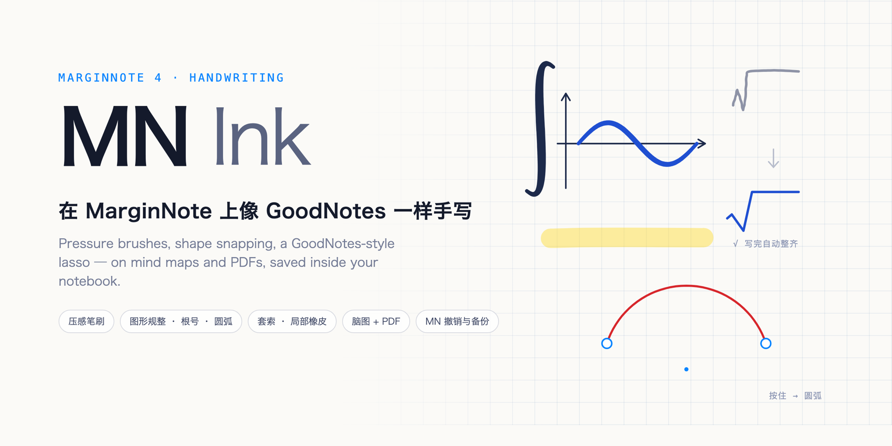

  

  
  
  
  

<a href="README.md">简体中文</a> · <b>English</b>

---

**MN Ink** is a MarginNote 4 add-on that brings Notability / GoodNotes-style handwriting to MarginNote: pressure brushes, hold-to-snap shapes, tidy square roots, a GoodNotes-style lasso, a partial eraser, grid paper and a laser pointer — **on mind maps and on PDF pages**.

Ink is vector, drawn straight into MarginNote's own mind map canvas and PDF content layer, so it scrolls and zooms with them and stays sharp. **It is stored inside the notebook**, so MarginNote's backups, iCloud sync, exports and ⌘Z undo all cover it.

## ✨ Features

| | |
| --- | --- |
| ✒️ **Brushes** | fountain pen (pressure), ballpoint, brush (tapered), pencil; **pressure sensitivity 0–100 %**; each size preset adjustable **10 %–400 %** |
| 🖍 **Highlighter** | translucent, always below the ink; optional auto-straighten, or hold to straighten |
| 📐 **Shapes** | hold still after a stroke → line, arrow, **arc** (ends snap, chord straightened), circle, ellipse, rectangle, triangle, polygon, polyline; **keep dragging to adjust** (length, angle, size, sweep); shape tool recognises every stroke, dashed guide lines |
| √ **Square roots** | a written √ turns into a clean radical (tuned on real handwriting); drag to extend the bar |
| 🧲 **Snapping** | ends and corners snap to other shapes' nodes and to the grid; 15° angle steps, near-horizontal / vertical lines straighten |
| ⭕ **Lasso (GoodNotes style)** | **anything the lasso touches is selected**; freehand or rectangle; filter by handwriting / highlighter / shapes; move, resize, **rotate**, recolour, copy, cut, paste, duplicate, delete; drag a single shape's **nodes** |
| 🩹 **Eraser** | whole-stroke or partial (cuts strokes); highlighter-only; auto-switch back; **scribble to erase** (as in GoodNotes: scribble over writing to erase it) |
| 🎨 **Colours** | favourites + recent + 28-colour palette + **hex input** + system picker |
| 🔴 **Laser pointer** | glowing trail for presenting; fades away, never saved |
| 🗒 **Writing paper** | squares / dots / lines in three sizes, shown only while writing |
| 📄 **PDF pages** | write on documents; ink stays with its page; switch between mind map and PDF when both are on screen |

## 🔗 Deep MarginNote integration

- **Takes over MarginNote's pen buttons** (mind map toolbar, PDF tool picker): they become an on/off switch for MN Ink and no longer enter MarginNote's handwriting mode (no zoom jump, no MarginNote paper background). Can be turned off. To edit handwriting made with MarginNote's own pen: Settings → 暂时用 MN 自带笔.
- **Palm rejection**: a hand resting on the iPad neither pans the view nor triggers the two-finger-tap undo.
- **Stored in the notebook**: each notebook gets one hidden "ink storage" note (hidden like MarginNote's own AI chats and sketch layers), one record per card / PDF page. Therefore
  - MarginNote **backups, iCloud sync and .marginpkg exports include the ink**;
  - **every stroke is one step of MarginNote's undo history**: the toolbar's undo *is* MarginNote's undo, and undoing from the menu or ⌘Z updates the ink immediately.
- **Ink follows cards**: mind-map ink is anchored to the nearest card and moves / hides with it.

## 🚀 Install

1. MarginNote → Settings → Extension → enable **Allow uncertified extensions** (on iPad too).
2. Download [`MNInk.mnaddon`](https://github.com/Jacky1n7/mn-ink/releases/latest/download/MNInk.mnaddon) and open it with MarginNote (double-click on Mac; AirDrop / Files on iPad), then restart when asked.
3. Open a notebook and tap the pen icon in the add-on bar (or MarginNote's own pen). "完成" (Done) leaves writing mode.

## ⚠️ Known limits

- **Apple Pencil double tap cannot switch to the eraser**: MarginNote does not expose Pencil double tap (UIPencilInteraction) to add-ons. Scribble to erase instead.
- Handwriting made with MarginNote's own pen is PencilKit ink that add-ons cannot read; MN Ink's eraser and lasso do not touch it.
- The storage note shows up in MarginNote's **AI chat history** as "✒️ MN Ink 手写笔迹存储（请勿删除）". If deleted, ⌘Z restores it and the add-on rebuilds it from memory.
- A notebook with no hidden note at all (never used AI chat or handwriting) keeps ink in a local file first and moves it into the notebook later.
- PDFs: vertical scroll mode only; zoom PDFs with MarginNote's own gestures.
- Relies on MarginNote's undocumented view hierarchy (tested on 4.4.6).

## 🛠 Development

See the Chinese README for commands (`npm test`, `npm run build`, `npm run build:dev`, `node scripts/dev.mjs push`).

## 🙏 Thanks

[perfect-freehand](https://github.com/steveruizok/perfect-freehand) (MIT, vendored), [mn-docs](https://mn-docs.museday.top), the MarginNote team and community.

## 📄 License

[MIT](LICENSE) © 2026 Xiaoran Li ([@Jacky1n7](https://github.com/Jacky1n7)). MarginNote is a trademark of the MarginNote team; this project is not affiliated with them.
